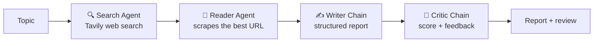

# ResearchMind: Multi-Agent Research System

A multi-agent AI system that researches any topic on the web and writes a structured, reviewed report.
Two LangChain agents gather the information (web search and page scraping), and two LLM chains turn it into a
report and then critique it. It runs from the terminal or as a Streamlit web app.

## How it works



| Step | Component | What it does |
|---|---|---|
| 1 | **Search Agent** | A LangChain agent with the `web_search` tool. Uses Tavily to find recent, reliable sources (top 5 results: title, URL, snippet). |
| 2 | **Reader Agent** | A LangChain agent with the `scrape_url` tool. Picks the most relevant URL from the search results and scrapes its text (BeautifulSoup; scripts, styles, nav and footer removed; first 3,000 characters). |
| 3 | **Writer Chain** | Prompt → Mistral → text. Combines the search results and scraped content into a report with an Introduction, Key Findings (at least 3), a Conclusion and Sources. |
| 4 | **Critic Chain** | Prompt → Mistral → text. Reviews the report and returns a score out of 10, strengths, areas to improve and a one-line verdict. |

All agents and chains use Mistral (`mistral-small-2506`, temperature 0) through `langchain-mistralai`.

## Tech stack

* **LangChain** (`create_agent`, prompt templates, output parsers)
* **Mistral AI** as the LLM
* **Tavily** for web search
* **Requests + BeautifulSoup** for scraping
* **Streamlit** for the web interface
* **python-dotenv** for API keys, **rich** for terminal output

## Project structure

```
a_tools.py         Tools: web_search (Tavily) and scrape_url (requests + BeautifulSoup)
b_agents.py        Mistral model, search agent, reader agent, writer chain, critic chain
c_pipeline.py      run_research_pipeline(topic): runs the 4 steps in order (terminal version)
d_app.py           Streamlit web app "ResearchMind" with live pipeline progress and report download
requirements.txt   Pinned Python dependencies
```

## Setup

1. Clone the repository and open the folder:

   ```bash
   git clone https://github.com/hassankhursheed/multi_agent_research_system.git
   cd multi_agent_research_system
   ```

2. Create and activate a virtual environment (Python 3.10 or newer):

   ```bash
   python -m venv venv
   venv\Scripts\activate        # Windows
   source venv/bin/activate     # macOS / Linux
   ```

3. Install the dependencies:

   ```bash
   pip install -r requirements.txt
   ```

4. Create a `.env` file in the project folder with your API keys:

   ```
   MISTRAL_API_KEY=your_mistral_api_key
   TAVILY_API_KEY=your_tavily_api_key
   ```

   Get keys from [Mistral AI](https://console.mistral.ai/) and [Tavily](https://tavily.com/). The `.env` file is
   listed in `.gitignore`, so it is never committed.

## Usage

### Web app (Streamlit)

```bash
streamlit run d_app.py
```

Open the URL Streamlit prints (usually http://localhost:8501), enter a research topic and click **Run System**.
The app shows each agent's progress live, then displays the report, the critic's score and feedback, and the raw
search and scraped content. You can download everything as a `.txt` file.

### Terminal

```bash
python c_pipeline.py
```

Enter a topic when prompted. Each step's output is printed as it finishes.

### From your own code

```python
from c_pipeline import run_research_pipeline

state = run_research_pipeline("Latest advances in solid-state batteries")
print(state["report"])
print(state["feedback"])
```

`run_research_pipeline` returns a dictionary with `search_results`, `scrapped_content`, `report` and `feedback`.

## Notes

* Search and scraping need internet access. Some websites block scraping; the reader agent then returns an error
  message instead of page text, and the report relies on the search snippets.
* The critic's score is the model's own opinion of the report, not a verified accuracy check.
